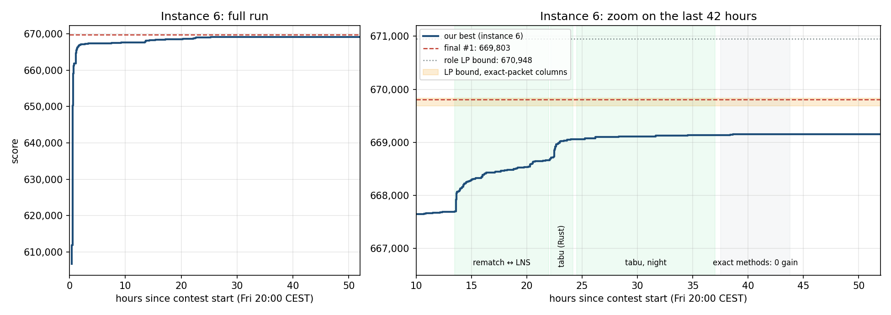
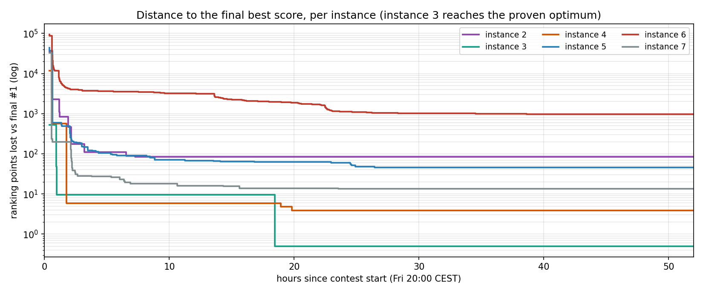

# 52 Hours of Combinatorial Optimisation: the Euro-Information 2026 Code Contest

*A technical write-up of my entry to the Euro-Information / Isograd optimisation contest (9-11 October 2026):
the problem, the 19 methods I tried, what worked, what did not, and a scorer vulnerability found along the way.*

> **TL;DR**
> - **Result:** 6,998,884 / 7,000,000 points, **42nd** in the standings at 21:15 CEST on Sunday (provisional,
>   before the 23:59 close). The top 42 teams were separated by **0.016 %**.
> - **Instances 1 and 3 solved to proven optimality**; instances 2, 4, 5 and 7 within 0.001-0.008 % of the best
>   score in the field. Almost the entire gap to the leader (966 of 1,116 points) is on a single instance.
> - **Best ideas:** LP-guided initialisation, LNS with a *waste-penalised* acceptance rule, exact subset-sum packing,
>   an exact "rematch" MIP, and a tabu search written in Rust (85-170k moves/s).
> - **Key finding:** on data-starved instances, *choosing which models to train* is easy; *packing datasets into
>   requirement windows without waste* is the whole game.
> - **Side quest:** the official scorer accepted negative indices, letting a model be counted twice. I proved it,
>   reported it, did not use it, and the organisers fixed the scorer and recomputed the leaderboard.

---

## 1. The contest

- **Format:** 52 hours (Friday 20:00 to Sunday 23:59, CEST), 7 input files, one optimisation problem.
  Only solutions (JSON) are submitted, never code.
- **Scoring:** each file is worth `1,000,000 × your_score / best_score_in_the_field`. A 0.1 % gap on any file
  costs ~1,000 points, whatever the file size.
- **Tools allowed:** anything. I used a home server, a rented cloud machine and an AI coding agent.

## 2. The problem

You run an AI lab with a fixed **energy budget**. You may train any subset of **models**; each model has a
**value**, an **energy cost**, and **data requirements**: for each data type it needs (`n`, `t`, `i`, `c`), the total
size of the datasets you give it must fall inside a window `[lowerBound, upperBound]`. Each **dataset** has a type,
a size and a copyright flag, and can be given to at most one model.

Two rules make it interesting:

1. **Copyright penalty.** A model trained on at least one copyrighted dataset is worth `value // 2`.
2. **Generators.** A model with a single requirement can act as a *synthetic data generator*: it covers one
   requirement of another model entirely. The generator's value is lost (its energy still counts) and the target is
   worth `value // 2`. The two penalties do not stack.

Objective: maximise the total value of trained models.

```
maximise   Σ_m  value_m · (full_m + ½ · half_m)
subject to Σ_m  energy_m · (full_m + half_m + gen_m)  ≤  energyCap
           for each trained model m and each required type t (not covered by a generator):
               lb_{m,t}  ≤  Σ_{d assigned to (m,t)} size_d  ≤  ub_{m,t}
           each dataset used at most once; full-price models use non-copyrighted datasets only
           each generator covers at most one requirement of one target; generators are not targets
```

It is a mix of a **multi-dimensional knapsack** (which models, at which price), a **generalised assignment /
bin-covering problem** (which datasets fill which window) and a **matching** (which generator feeds which target).

Vocabulary used below: a **slot** is a (model, data type) pair to fill; a **packet** is the set of datasets assigned
to a slot; **waste** is `Σ (packet size − lowerBound)` over slots filled with datasets.

### The seven instances

| # | name | models | datasets | energy cap / total energy | data supply / demand | copyrighted | notes |
|---|---|---|---|---|---|---|---|
| 1 | example | 5 | 5 | 0.61 | n/a | 60 % | solved by exhaustive search |
| 2 | medium | 3,000 | 10,000 | 0.137 | ~0.35 | 66 % | energy and data both binding |
| 3 | free | 5,000 | 20,000 | 0.126 | ~0.42 | 0 % | no copyright at all |
| 4 | precise | 8,000 | 40,000 | 0.168 | ~0.50 | 50 % | no single-requirement model (no generators); very narrow windows |
| 5 | energy | 11,000 | 100,000 | **1.087** | ~0.96 | 66 % | energy is not binding; only data matters |
| 6 | shortage | 15,000 | **5,000** | 0.132 | **~0.04** | 41 % | extreme data shortage; generators are essential |
| 7 | big | 50,000 | 250,000 | 0.172 | ~0.53 | 66 % | size |

Every instance also contains requirements with `ub < lb`: these can only be satisfied by a generator.

## 3. Setup and workflow

| component | details |
|---|---|
| Home server | Proxmox VE on a Ryzen 7 5800X3D, one Ubuntu 24.04 VM with 14 vCPUs and 23 GB RAM |
| Cloud | AWS `c7i.12xlarge` (48 vCPUs, Paris), on-demand, ~26 hours on Saturday and Sunday |
| Languages | Python (NumPy, Numba) for most of the code, Rust for the tabu search |
| Solvers | HiGHS (via `highspy` and `scipy`), Google OR-Tools CP-SAT |
| Development | Claude Code (Anthropic), first as a pair programmer, then as an orchestrator of parallel sub-agents, each testing one method in its own files |

Three engineering decisions paid off throughout the weekend:

- **`save_if_better.py`, the single gate to `best/`.** Every candidate solution is re-scored with the official
  checker, written only if strictly better, protected by a file lock and committed to git. It absorbed 399
  improvements from up to 60 concurrent processes on two machines without losing or corrupting a single solution.
- **Autonomous, time-boxed runs.** Every long job was launched with `setsid nohup ... --until <UTC time>`, so
  computations survived SSH disconnects and AI session limits.
- **A two-way cloud sync** every 3 minutes: AWS improvements were validated and committed locally, and the local
  best was pushed to AWS as a new starting point.

## 4. Results

| inst | my score | best in the field | gap | known upper bound | type of bound |
|---|---|---|---|---|---|
| 1 | **12,946** | 12,946 | 0 | 12,946 | proven optimum (exhaustive search) |
| 2 | **272,299** | 272,322 | −23 (−0.008 %) | 272,396 | integer role MIP (valid) |
| 3 | **523,758** | 523,758 | 0 | 523,758 | **proven optimum** (role MIP = bound) |
| 4 | **1,031,937** | 1,031,941 | −4 (−0.0004 %) | 1,031,947 | role LP relaxation |
| 5 | **3,785,933** | 3,786,108 | −175 (−0.005 %) | 3,786,540 | role LP relaxation |
| 6 | **669,156** | 669,803 | −647 (−0.097 %) | 670,948 | role LP relaxation (perfect packing) |
| 7 | **5,822,483** | 5,822,561 | −78 (−0.001 %) | 5,823,268 | role LP relaxation |

**Total: 6,998,884 / 7,000,000.** Points lost against the leader: 966 on instance 6, 84 on instance 2, 46 on
instance 5, 13 on instance 7, 4 on instance 4.

Compared with the reference `starter.py` provided by the organisers:

| inst | starter | first greedy (2 × 3 min) | final | gain |
|---|---|---|---|---|
| 2 | 71,486 | 263,198 | 272,299 | ×3.8 |
| 3 | 167,236 | 523,483 | 523,758 | ×3.1 |
| 4 | 64,137 | 1,019,909 | 1,031,937 | ×16 |
| 5 | 0 (skipped) | 3,646,547 | 3,785,933 | n/a |
| 6 | 97,804 | 611,810 | 669,156 | ×6.8 |
| 7 | 0 (skipped) | 5,631,084 | 5,822,483 | n/a |



*Instance 6 over the whole contest (left) and zoomed (right). Green bands: phases that produced gains; grey band:
six exact methods tried in parallel on Sunday, none of which improved the incumbent.*



*Ranking points lost against the final best score, per instance (log scale; instance 3 reaches 0, drawn at 0.5).
About 95 % of the total gain came in the first two hours; the next 40 hours were spent on the last 0.1-0.5 %.*

## 5. What worked, in chronological order

### 5.1 A parametrised greedy (first 10 minutes)
Model priority = `effective_value / (α · energy/cap + Σ_t β_t · lb_t / supply_t)`, i.e. a Lagrangian-style price for
each resource, with a full-price and a half-price option for every model. Random search over (α, β, γ) took
instance 2 from 71k to 263k. The main lesson came from the parameters: the best runs priced data far below the naive
demand/supply ratio, because energy dominated.

### 5.2 LP-guided initialisation + Large Neighbourhood Search (the workhorse)
A linear relaxation of the *role* problem (each model is full price, half price, generator or unused, with energy,
per-type data supply and generator-coverage constraints) solves in about a second. It gives an **upper bound** and
**dual prices** for energy and each data type. Training the models at `x = 1` in the LP, then running an LNS
(destroy *k* models with their generators, rebuild greedily with noise, accept if not worse) gave the biggest single
jump of the contest: instance 6 from 611,810 to 650,291 in 30 seconds, instance 4 from 1,019,909 to 1,031,349.

Two additions on Friday night were decisive:
- **Waste-penalised acceptance:** accept a neighbour if `value − μ · waste` does not decrease, with μ the average dual
  price of data. Freed data then accumulates instead of being wasted again. Instance 6 waste dropped from 2.0 % to
  1.3 %, and the score rose by ~4,250 in an hour.
- **Exact subset-sum packing** with a bitset (validated against brute force). Taking large datasets first mattered:
  on instance 4 it reached **zero waste** (1,031,935), where increasing order stalled at 941k.

### 5.3 Exact role MIP + realisation
Making the role model integer (HiGHS, 30-600 s) and then *realising* it with exact subset-sum packing proved
**instance 3 optimal** (523,758 in 30 s: the MIP value equals the bound and the realisation never fails, because
only 49 % of the data is needed). The same pipeline brought instance 4 to 10 points of its bound.

### 5.4 Rematch: an exact "packets ↔ requirements" MIP
Keep the current packets (plus their subsets of 1-5 datasets) and solve exactly which packet goes to which slot,
together with the roles and the energy budget. Two practical points made it work: **`highspy` with the current
solution as a hint** (`scipy.milp` found no integer solution in 15 minutes without one), and alternating it with the
LNS, which keeps producing new packets. It gave instance 6 its Saturday-morning gains (667,690 to 668,666), then
slowed to about +20 per hour.

### 5.5 Tabu search on dataset assignment, in Rust (best gain per core-hour after Friday)
With roles fixed, the tabu minimises a dual-price-weighted data consumption minus `λ · Σ excess²`, a term that
*concentrates* excess on few slots in order to free whole datasets. Moves: remove, move, insert, swap,
**swap-then-remove**, 3-cycle-then-remove. 708 lines of Rust running at 85-170k moves/s. Each cycle is
*tabu (1-3 min) → LNS (2-10 min, converts freed datasets into value) → rematch*.

Result: **+345 in two hours** on instance 6 (668,711 to 669,056, waste 0.83 % to 0.68 %), against +20/h before.
It then plateaued: +81 over a night on 52 cores.

## 6. What did not work, and why

| method | idea | outcome | why |
|---|---|---|---|
| Simulated annealing in the LNS | accept worse neighbours | never better than plateau acceptance | accepting equal-score moves already explored the plateau (tested on instance 6 only) |
| Small CP-SAT repairs, CP-SAT by blocks | exact packing of 250-slot blocks | −37 % waste on sub-problems, no value gain | the `x[dataset, slot]` formulation is too symmetric |
| Alternative role "basins" | restart from other MIP roles | started 1,400-8,000 points lower | hours to climb back, never caught up |
| Path relinking | walk between elite solutions | 0 in 14 pairs | the elite solutions lie on the same plateau |
| Column generation | price new packets with LP duals | +2 per iteration, LP > 300 s | highly degenerate master; value sits in the slot rows, datasets have zero duals |
| "Effective supply" loop | role MIP with reduced supply to anticipate waste | 1,400 below best | greedy realisation wasted twice as much |
| Exact packets with fixed roles (m2) | set partitioning over tight subsets | +100/h on loose solutions, 0 on best | LP margin of 0.03 % on a polished solution |
| Targeted CP-SAT (m4) | re-solve the 275 high-excess slots | "feasible, no gain" in 19 rounds | same symmetry issue |
| Tailored windows (m5) | swap the model occupying a bad slot | 0 swaps | all small windows already in use |
| Memetic algorithm (m6) | crossover + tabu on children | +19 | the tabu brings every child back to the parent's plateau |
| Exact dataset-level MIP on instance 2 (m7) | solve instance 2 exactly | bound 272,396 found, but no better integer | packing degeneracy again |
| Free-role exact-packet columns (m9) | one MIP choosing roles *and* packets | 77 MIPs × 2,000 s, 0 gain | 170k+ columns leave no time for branch-and-bound |
| LP-guided diving / RINS (m9) | fix what LP and incumbent agree on | small neighbourhoods *proven* empty | improvements require undoing packets the LP only half-supports |
| Global CP-SAT (m10) | one exact model, incumbent as hint | 0 gain in 7 × 20 min | bounds 9-15k above the LP, internal LNS finds nothing |

## 7. Why instance 6 plateaued

Three facts, established by the "failed" exact methods of the last day, explain the final gap.

1. **Roles are not the problem.** At the current waste level, the ideal role choice is worth only ~45 points more
   than mine. The LP is almost integral on roles (9 fractional values out of 4,849) and highly fractional on packets.
2. **Energy and data are both saturated.** Energy is used at 99.99998 % and 4,999 of 5,000 datasets are in use. The
   only remaining moves are half-price-to-full-price switches (two candidates, +29 at most) or model swaps that require
   repacking many slots at once. The remaining waste (0.65 %) is scattered at ~47 units per slot: useless unless
   everything is repacked together.
3. **The plateau is degenerate.** The 24 best night solutions differ by 2,400-3,000 packets but share the same roles
   and the same waste on 3 of the 4 data types: thousands of equivalent solutions, none better. Diversity methods
   (elite pools, relinking, memetic) only recombine points of the same plateau.

The most telling number comes from m9: the LP bound of the formulation "roles + exact packets of 1-3 datasets" is
**669,688-669,830**, about 1,100 points below the role LP bound, purely because datasets come in indivisible sizes.
The final leader (669,803) sits **inside that band**: the top teams solved the packing almost to the limit of that
formulation. Closing my last 647 points therefore required a better *integer* packing, not better roles, and none of
my exact approaches could find one in the time available.

## 8. A scorer vulnerability, responsibly reported

On Friday night, scores started appearing above what my upper bounds allowed. On instance 3, even the loosest valid
bound (fractional knapsack on energy alone, every model at full value, data constraints ignored) gives **524,851**,
computed independently with exact rational arithmetic and with HiGHS. Several teams displayed **525,726**.

The cause was in the provided `test_solution.py`: `dataMappings` indices were range-checked, but **`modelMappings`
indices were not**. Python accepts negative indices, so `-2` silently aliases model `n − 2`, and the same model can be
counted twice. A minimal reproduction:

```python
# Two models (values 1,000 and 10), two non-copyrighted datasets.
# The sum of ALL model values is 1,010: no valid solution can exceed it.
legal   = {"dataMappings": [[0, 0], [1, 1]], "modelMappings": []}         # scored 1,010 (valid)
exploit = {"dataMappings": [[0, 0], [1, 1]], "modelMappings": [[1, -2]]}  # scored 1,500 (accepted)
# Control: a negative index in dataMappings is correctly rejected ("Model -2 does not exist").
```

Timeline: found and proven on Friday night, then reported to the organisers with the reproduction above. Isograd
confirmed it on Saturday morning, fixed the scorer and recomputed the leaderboard before noon. I never submitted a
solution using it. My own `save_if_better.py` rejects any index outside `[0, n)`.

What I take from it: an **upper bound** is the cheapest anomaly detector there is. A one-line fractional-knapsack
computation turned "these teams are very good" into "these scores are impossible".

## 9. Engineering lessons

- **HiGHS:** crashed beyond ~1M columns; dual simplex was very slow on degenerate LPs (572 s for 173k columns) while
  the IPM was 3-5× faster but is not used inside the MIP; `scipy.milp` cannot take a starting solution, which made it
  unusable on large models; thread count cannot be set through scipy (pin processes with `taskset`).
- **CP-SAT:** with an `x[dataset, slot]` formulation it proved nothing even on 17 × 27 sub-problems; useful only with
  a full hint and a small neighbourhood.
- **`highspy` and `ortools` cannot be imported in the same Python process** (symbol conflict): use sub-processes.
- **`pkill -f pattern` kills its own calling shell** when the pattern appears in its command line: anchor with `^`.
- **One bug cost a whole night:** the generator picker tried only 4 candidates, so the "all-generator" option placed
  479 of 1,248 targets instead of 1,186. A diagnostic run on Saturday morning found it in minutes.
- **AI agents need the same discipline as humans:** separate files per agent, one validated gate for results, written
  notes (`RAPPORT.md`, `JOURNAL.md`) so a fresh session can resume after its context is cleared, and explicit
  checkpoints with stop rules ("if no gain by 17:00, revert").

## 10. What I would do differently

1. **Measure waste from hour one.** It was the real objective on four of the seven instances; I made it explicit only
   on Friday night and fully understood it on Saturday afternoon.
2. **Write the inner loops in Rust from the start.** The Python LNS ran at ~1 iteration/s on instance 7 and ~10/s on
   instance 6, while the Rust tabu evaluated 85-170k moves per second.
3. **Launch the tabu search on Saturday morning**, not Saturday evening: it was the best method per core-hour after
   Friday.
4. **Spend less compute on exact global models.** About 400 core-hours of exact methods produced a valuable diagnosis
   but no points.
5. **Unexplored leads**, in order of expected value: a global per-type repacking with very tight columns
   (`sum ∈ [lb, lb + 5]`) followed by half-to-full switches; column generation priced per *model* with proper dual
   stabilisation; a tabu objective aimed at freeing exactly the dataset sizes that the two switch candidates need.

## 11. Repository layout

```
*.sh                       launch scripts: night runs, LNS/rematch loops, cloud sync, status
src/
  save_if_better.py        the single validated gate to best/ (official checker + lock + git commit)
  greedy.py, lp_bound.py, lns.py, elite.py      greedy, LP bounds, LNS, relinking
  rematch.py               packets ↔ requirements MIP
  fin_*.py                 exact finishing on instances 2-5 and 7
  m2_* ... m10_*           the parallel methods of Saturday and Sunday
  m3_tabu/src/main.rs      tabu search (Rust)
notes/
  ANALYSE.md, JOURNAL.md, BILAN.md, MIP6_PLAN.md, M*.md   analysis, logbook, per-method notes (French)
  progression.csv          every improvement (time, instance, score, method), used for the charts
best/scores.json           best score per instance
assets/                    charts used in this README
```

### How to run

The contest statement, input files, `starter.py` and the official checker `test_solution.py` belong to the organisers
and are **not included**. To run the code, place `test_solution.py` at the repository root and the input files in
`datasets/`, then create a Python environment with `numpy`, `scipy`, `numba`, `highspy` and `ortools`, and build the
tabu search with `cargo build --release` in `src/m3_tabu/`. Many scripts were written for a specific machine and
time-boxed runs (`--until <UTC time>`), so expect to adapt paths and durations.
